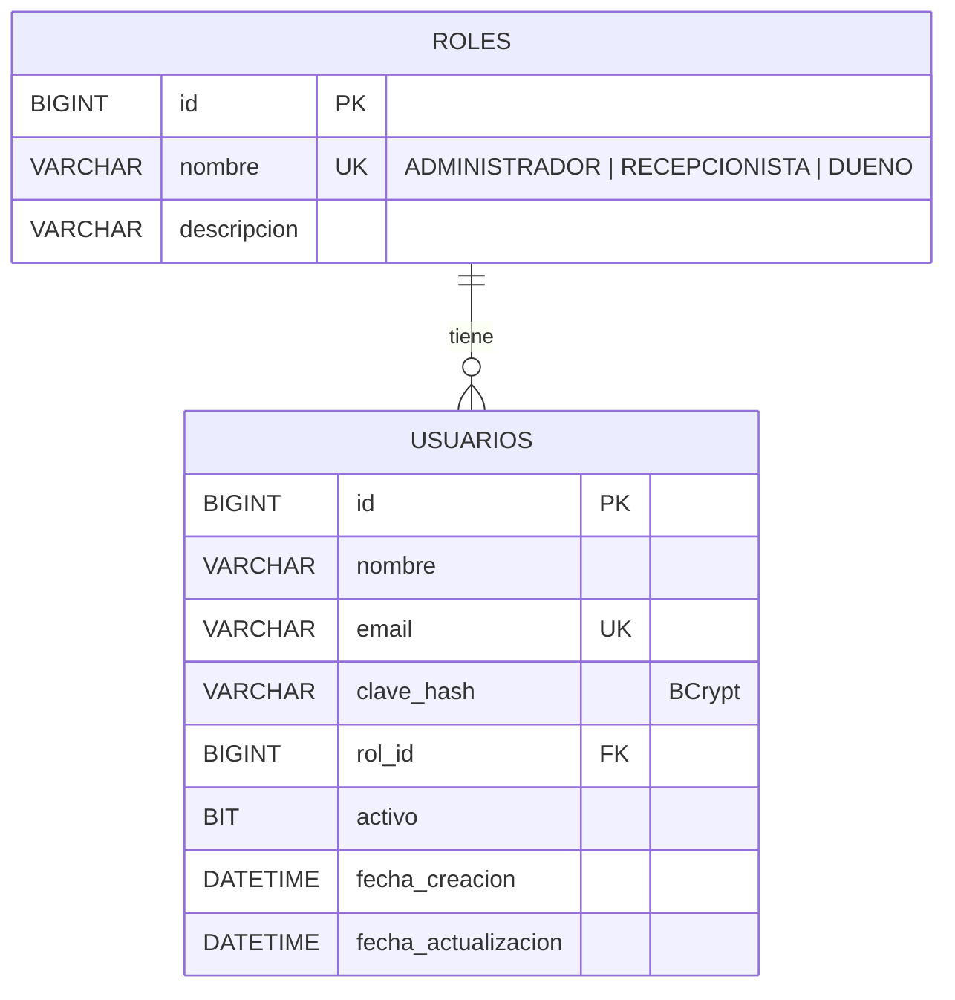
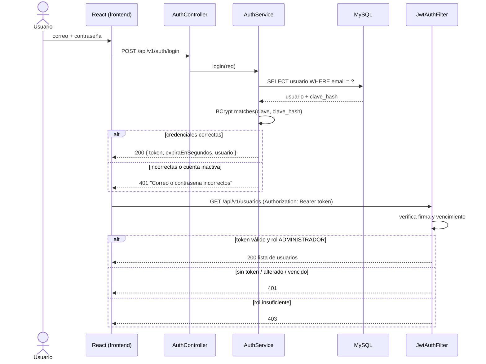

# Veterinaria San Marcos · Backend (Parcial 3)

**Curso:** DSY1104 · Desarrollo Fullstack II · Duoc UC · 2026
**Caso:** Veterinaria San Marcos (Forma A)
**Frontend:** https://github.com/eliasgonzalez22/veterinaria-sanmarcos-p2

| Integrante | Correo | GitHub |
|---|---|---|
| Elias Gonzalez Abraham Hernandez | eliaa.gonzalez@duocuc.cl | eliasgonzalez22 |
| Javier Ignacio Alegría Vargas | jav.alegria@duocuc.cl | jav-rgb |
| Sebastian Manuel Leon Rodriguez | sebas.leonr@duocuc.cl | sebastian5180 |

---

## Estado del trabajo (avance lunes 16 de noviembre)

**Leyenda:** **Listo** = probado en Swagger/Postman y el dato queda guardado en MySQL · **En avance** = ruta y lógica creadas con commits, falta terminar o probar · **Pendiente** = aún no se empieza.

| Operación | Endpoint | Diseñado | Implementado | Probado | Estado |
|---|---|:-:|:-:|:-:|---|
| Tabla de usuarios (MySQL, persistente, clave con hash BCrypt) | `usuarios`, `roles` | ✅ | ✅ | ✅ | **Listo** |
| Inicio de sesión con JWT (error genérico si falla) | `POST /api/v1/auth/login` | ✅ | ✅ | ✅ | **Listo** |
| Registro (rol `DUENO` asignado por el servidor) | `POST /api/v1/auth/registro` | ✅ | ✅ | ✅ | **Listo** |
| Alta de usuario con rol (Administrador) | `POST /api/v1/usuarios` | ✅ | ✅ | ⬜ | En avance |
| Listar usuarios (Administrador) | `GET /api/v1/usuarios` | ✅ | ✅ | ⬜ | En avance |
| Ver usuario (el mismo o Administrador) | `GET /api/v1/usuarios/{id}`, `GET /api/v1/usuarios/yo` | ✅ | ✅ | ⬜ | En avance |
| Modificar usuario (rol/estado solo Administrador) | `PUT /api/v1/usuarios/{id}` | ✅ | ✅ | ⬜ | En avance |
| Eliminar = desactivar usuario (Administrador) | `DELETE /api/v1/usuarios/{id}` | ✅ | ✅ | ⬜ | En avance |
| Rutas protegidas 401 / 403 | Filtro JWT + `SecurityConfig` | ✅ | ✅ | ⬜ | En avance |
| Login y registro del frontend consumiendo la API | Repo frontend | ✅ | ⬜ | ⬜ | Pendiente (semana 15) |
| Microservicio de catálogo de servicios | `/api/v1/servicios` | ⬜ | ⬜ | ⬜ | Pendiente (semana 16) |
| Microservicio de citas (regla 409: horario ocupado) | `/api/v1/citas` | ⬜ | ⬜ | ⬜ | Pendiente (semana 16) |

---

## Decisiones técnicas

| Tema | Decisión | Por qué |
|---|---|---|
| Framework | Spring Boot 3.3 (Java 17) | Lo pide el documento del caso (Forma A) y la pauta de la Coordinación. |
| Arquitectura | Un microservicio por responsabilidad: `ms-usuarios` (este), luego `ms-catalogo` y `ms-citas` | El caso exige microservicios independientes, cada uno con su propia BD. |
| Base de datos | MySQL 8, BD `sanmarcos_usuarios` | Relacional en servidor, preferida en el caso. `ddl-auto=update` conserva los datos al reiniciar. |
| Modelo | Tablas `roles` y `usuarios` (FK `rol_id`) | 3FN: el nombre del rol no se repite en cada usuario. |
| Contraseñas | BCrypt (`BCryptPasswordEncoder`) | Hash con sal aleatoria; la clave nunca se guarda ni se devuelve. |
| Autenticación | JWT HS256 (jjwt 0.12), vigencia 60 min | API sin estado: cada petición trae `Authorization: Bearer <token>`. |
| Roles | `ADMINISTRADOR`, `RECEPCIONISTA`, `DUENO` | Roles mínimos del caso. El registro público siempre crea `DUENO`. |
| Eliminar | Borrado lógico (`activo = false`) | No se pierde el historial de citas del usuario. Un usuario inactivo no puede iniciar sesión. |
| Errores | JSON único (`estado`, `error`, `mensaje`, `ruta`, `fecha`, `errores`) | 400 dato inválido, 401 sin token / vencido, 403 rol insuficiente, 404 no existe, 409 conflicto. |
| Documentación | springdoc-openapi (Swagger UI) | Se documenta y prueba la API con el botón **Authorize**. |
| Secretos | Variables de entorno (`DB_PASSWORD`, `JWT_SECRET`) | No hay claves ni archivos `.env` en el repositorio. |

---

## Modelo entidad-relación



Script de referencia: [`ms-usuarios/db/schema.sql`](ms-usuarios/db/schema.sql).

## Diagrama de secuencia: inicio de sesión y ruta protegida



---

## Endpoints (`ms-usuarios`, puerto 8081)

| Método | Ruta | Acceso | Respuestas |
|---|---|---|---|
| POST | `/api/v1/auth/registro` | Público | 201, 400, 409 |
| POST | `/api/v1/auth/login` | Público | 200, 400, 401 |
| GET | `/api/v1/usuarios/yo` | Con token | 200, 401 |
| GET | `/api/v1/usuarios` | ADMINISTRADOR | 200, 401, 403 |
| GET | `/api/v1/usuarios/{id}` | El mismo usuario o ADMINISTRADOR | 200, 401, 403, 404 |
| POST | `/api/v1/usuarios` | ADMINISTRADOR | 201, 400, 401, 403, 409 |
| PUT | `/api/v1/usuarios/{id}` | El mismo usuario (nombre, correo, clave) o ADMINISTRADOR (además rol y activo) | 200, 400, 401, 403, 404, 409 |
| DELETE | `/api/v1/usuarios/{id}` | ADMINISTRADOR (desactiva) | 204, 401, 403, 404, 409 |

**Swagger:** `http://<IP-PUBLICA-EC2>:8081/swagger-ui.html` ← reemplazar por la dirección real.

---

## Cómo ejecutarlo

### Requisitos
Java 17+, Maven 3.9+, MySQL 8 (o Docker).

### 1. Base de datos
```bash
export DB_PASSWORD='una_clave_local'
docker compose up -d          # MySQL en el puerto 3306 con volumen persistente
```
(Si ya tienes MySQL instalado, basta con que exista el usuario; la BD se crea sola.)

### 2. Variables de entorno
| Variable | Ejemplo | Obligatoria |
|---|---|---|
| `DB_URL` | `jdbc:mysql://localhost:3306/sanmarcos_usuarios?createDatabaseIfNotExist=true` | No (ese es el valor por defecto) |
| `DB_USER` | `root` | No |
| `DB_PASSWORD` | la misma del paso 1 | Sí |
| `JWT_SECRET` | texto aleatorio de 32+ caracteres | Recomendado (si falta, se genera uno al iniciar) |
| `CORS_ORIGINS` | `http://localhost:5173,http://<IP-EC2>:5173` | No |
| `SEED_CLAVE` | clave de los usuarios de prueba (por defecto `123456`) | No |

Generar un secreto: `openssl rand -base64 48`

### 3. Ejecutar
```bash
cd ms-usuarios
mvn spring-boot:run
```
Abrir `http://localhost:8081/swagger-ui.html`.

### Usuarios de prueba (se crean solos al iniciar)
| Correo | Rol |
|---|---|
| admin@sanmarcos.cl | ADMINISTRADOR |
| recepcion@sanmarcos.cl | RECEPCIONISTA |
| dueno@sanmarcos.cl | DUENO |

Clave: el valor de `SEED_CLAVE`. Son datos de demostración, no cuentas reales.

### Probar en Swagger
1. `POST /api/v1/auth/login` con `{"email":"admin@sanmarcos.cl","clave":"123456"}` → copiar `token`.
2. Botón **Authorize** → pegar el token.
3. `GET /api/v1/usuarios` → 200. Repetir con el token de `dueno@sanmarcos.cl` → 403. Sin token → 401.
4. Reiniciar el backend y volver a listar: los usuarios siguen ahí (persistencia real).

---

## Estructura

```
ms-usuarios/
├── db/schema.sql                      Modelo de referencia
├── pom.xml
└── src/main/java/cl/duoc/sanmarcos/usuarios/
    ├── config/        SecurityConfig, OpenApiConfig, DataInitializer
    ├── controller/    AuthController, UsuarioController
    ├── dto/           Request/Response (validación con @Valid)
    ├── exception/     Errores JSON y GlobalExceptionHandler
    ├── model/         Usuario, Rol, RolNombre
    ├── repository/    UsuarioRepository, RolRepository (Spring Data JPA)
    ├── security/      JwtService, JwtAuthFilter, RespuestasSeguridad
    └── service/       AuthService, UsuarioService (lógica y permisos)
```
